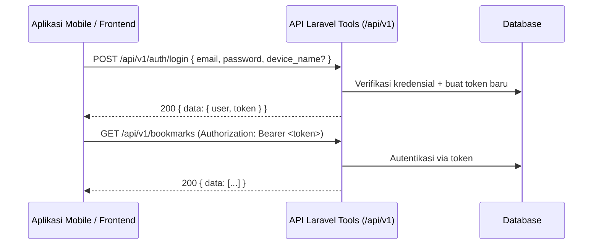
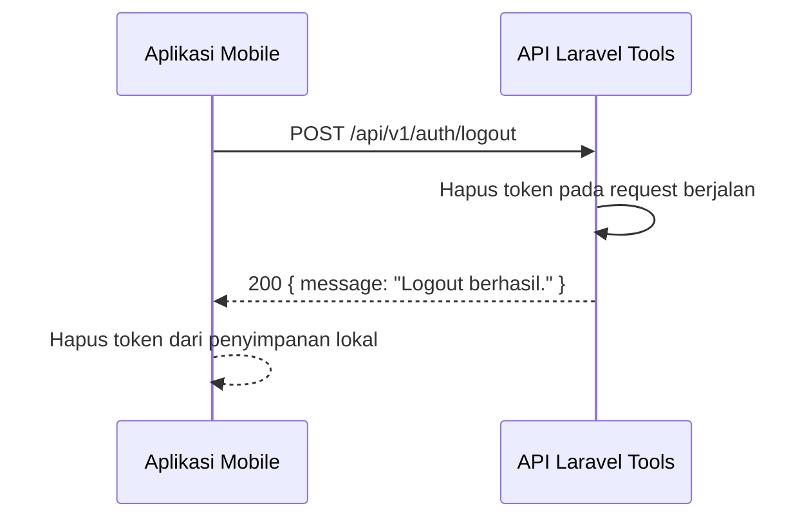

# Dokumentasi API Autentikasi

> Panduan REST API untuk **autentikasi** pada **Laravel Tools** — login, logout, profil, serta manajemen Personal Access Token (Sanctum) untuk dikonsumsi dari aplikasi mobile maupun frontend lain.

**Status**: Tersedia (sudah diimplementasikan)
**Versi API**: `v1`
**Dokumen ini ditujukan untuk**: developer frontend / mobile / Laravel project lain yang ingin berintegrasi.

---

## Daftar Isi

1. [Ringkasan](#1-ringkasan)
2. [Alur Kerja](#2-alur-kerja)
3. [Autentikasi API](#3-autentikasi-api)
4. [Membuat Token](#4-membuat-token)
5. [Endpoint API](#5-endpoint-api)
6. [Format Response](#6-format-response)
7. [Kode Status & Error Handling](#7-kode-status--error-handling)
8. [Contoh Integrasi](#8-contoh-integrasi)
9. [Pedoman Penggunaan dari Frontend](#9-pedoman-penggunaan-dari-frontend)
10. [Catatan Keamanan & Limitasi](#10-catatan-keamanan--limitasi)

---

## 1. Ringkasan

Modul autentikasi API menyediakan mekanisme **login**, **logout**, **akses profil**, serta **manajemen token** berbasis Laravel **Sanctum** Personal Access Token. Menjadi pintu masuk untuk seluruh endpoint REST lain yang dilindungi (mis. `/api/v1/bookmarks`, `/api/v1/bookmark-categories`).

Fitur yang tersedia:

- `POST /api/v1/auth/login` — tukar kredensial (email + password) menjadi **Bearer token**.
- `POST /api/v1/auth/logout` — nonaktifkan token yang sedang dipakai saat request.
- `POST /api/v1/auth/logout-all` — nonaktifkan **semua** token milik user.
- `GET /api/v1/auth/me` — ambil data user terautentikasi.
- `GET /api/v1/auth/tokens` — daftar seluruh token aktif milik user.
- `DELETE /api/v1/auth/tokens/{tokenId}` — cabut (revoke) satu token tertentu.

### Komponen utama

| Komponen | Lokasi |
|---|---|
| Controller API | `app/Http/Controllers/Api/V1/AuthController.php` |
| Route API | `routes/api.php` |
| Model | `app/Models/User.php` (Sanctum HasApiTokens) |
| Mekanisme token | `laravel/sanctum` |

---

## 2. Alur Kerja

### 2.1 Login dan memakai token



### 2.2 Logout



---

## 3. Autentikasi API

Aplikasi ini bersifat **internal, dipakai 1 user**, sehingga autentikasi memakai Laravel **Sanctum Personal Access Token** sesederhana mungkin namun tetap aman.

- **Metode**: Laravel **Sanctum** Personal Access Token.
- **Header** yang wajib dikirim pada endpoint terproteksi:

```
Authorization: Bearer <personal_access_token>
Accept: application/json
```

Semua endpoint **kecuali** `POST /api/v1/auth/login` wajib membawa token tersebut. Response data tetap discope `user_id` dari token (aman bila nanti ada banyak user).

---

## 4. Membuat Token

Token bisa didapat melalui dua cara:

### 4.1 Melalui halaman Login API

Kirim kredensial ke `POST /api/v1/auth/login` — response berisi `token` siap pakai (lihat [5.1](#51-post-apiv1authlogin)).

### 4.2 Secara manual (dashboard / tinker)

```php
// Laravel / Tinker
$user = \App\Models\User::first();
$token = $user->createToken('mobile-app')->plainTextToken;
echo $token;
```

> **Catatan**: `plainTextToken` menampilkan token asli **hanya sekali** saat dibuat. Jika terlewat, buat token baru (mis. lewat `POST /auth/login` lagi atau `tokens()` management).

Menurut konfigurasi `config/sanctum.php`, **expiration = `null`** — artinya token **tidak kadaluarsa otomatis** oleh waktu dan hanya berhenti berlaku jika dicabut manual (dashboard, `logout`, `logout-all`, atau `DELETE /auth/tokens/{id}`).

---

## 5. Endpoint API

Base URL:

```
https://your-domain.com/api/v1
```

### 5.1 `POST /api/v1/auth/login`

Login dan buat token baru. Satu-satunya endpoint yang **tidak** membutuhkan token.

**Body**:

```json
{
    "email": "user@example.com",
    "password": "rahasia123",
    "device_name": "android-mobile"
}
```

**Aturan validasi**:

| Field | Rule |
|---|---|
| `email` | `required`, `email` |
| `password` | `required` |
| `device_name` | `string`, `max:255` (opsional) |

Jika `device_name` dikosongkan, sistem memakai `User-Agent` header sebagai nama token, atau fallback `unknown`.

**Response `200`**:

```json
{
    "message": "Login berhasil.",
    "data": {
        "user": {
            "id": 1,
            "name": "ERIE PUTRANTO",
            "email": "user@example.com"
        },
        "token": "1|xxxxxxxxxxxxxxxxxxxxxxxxxxxxxxxxxxxxxxxxxxxxxxxxxxxxxxxxxxxxxxxx"
    }
}
```

**Error `422`** — kredensial salah:

```json
{
    "message": "Kredensial yang diberikan tidak valid.",
    "errors": {
        "email": [
            "Kredensial yang diberikan tidak valid."
        ]
    }
}
```

> Response dihasilkan lewat `ValidationException`, sehingga HTTP status `422`. Karena response user dikirim lewat field `email`, frontend dapat menampilkannya di bawah input email.

### 5.2 `POST /api/v1/auth/logout`

Nonaktifkan **hanya token yang dipakai pada request ini** (`currentAccessToken()`).

- Wajib header `Authorization: Bearer <token>`.
- Tanpa body.

**Response `200`**:

```json
{
    "message": "Logout berhasil."
}
```

### 5.3 `POST /api/v1/auth/logout-all`

Nonaktifkan **seluruh** token milik user terautentikasi.

- Wajib header `Authorization: Bearer <token>`.
- Tanpa body.

**Response `200`**:

```json
{
    "message": "Semua token berhasil dihapus."
}
```

> Berguna saat user menganggap semua perangkat / token asing perlu dicabut sekaligus.

### 5.4 `GET /api/v1/auth/me`

Ambil profil user terautentikasi.

**Response `200`**:

```json
{
    "data": {
        "user": {
            "id": 1,
            "name": "ERIE PUTRANTO",
            "email": "user@example.com",
            "email_verified_at": "2026-01-01T00:00:00.000000Z",
            "created_at": "2026-01-01T00:00:00.000000Z"
        }
    }
}
```

### 5.5 `GET /api/v1/auth/tokens`

Daftar seluruh token milik user terautentikasi.

**Response `200`**:

```json
{
    "data": {
        "tokens": [
            {
                "id": 3,
                "name": "android-mobile",
                "abilities": ["*"],
                "last_used_at": "2026-08-15T12:00:00.000000Z",
                "created_at": "2026-08-15T11:50:00.000000Z",
                "expires_at": null
            },
            {
                "id": 1,
                "name": "postman",
                "abilities": ["*"],
                "last_used_at": "2026-08-10T09:00:00.000000Z",
                "created_at": "2026-08-05T08:00:00.000000Z",
                "expires_at": null
            }
        ]
    }
}
```

> `abilities` berisi kemampuan token (default `["*"]` = akses penuh). `expires_at` `null` karena expiration dinonaktifkan.

### 5.6 `DELETE /api/v1/auth/tokens/{tokenId}`

Cabut (revoke) **satu** token berdasarkan `id` (id yang sama dengan field `id` pada `GET /auth/tokens`).

**Response `200`**:

```json
{
    "message": "Token berhasil dihapus."
}
```

**Error `404`** — token tidak ditemukan / bukan milik user:

```json
{
    "message": "Token tidak ditemukan."
}
```

> Token milik user lain dikembalikan `404` (bukan `403`) agar tidak membocorkan keberadaan token.

### 5.7 Ringkasan endpoint

| Method | Endpoint | Auth | Deskripsi |
|---|---|---|---|
| POST | `/api/v1/auth/login` | ✗ | Login & buat token |
| POST | `/api/v1/auth/logout` | ✓ | Nonaktifkan token berjalan |
| POST | `/api/v1/auth/logout-all` | ✓ | Nonaktifkan semua token |
| GET | `/api/v1/auth/me` | ✓ | Data user terautentikasi |
| GET | `/api/v1/auth/tokens` | ✓ | Daftar seluruh token |
| DELETE | `/api/v1/auth/tokens/{tokenId}` | ✓ | Cabut satu token |

---

## 6. Format Response

Seluruh response API mengikuti struktur JSON:

- **Sukses**: `{ "data": ..., "message": "..." }` — `message` opsional, tersedia khusus pada aksi mutasi (login/logout).
- **Error**: `{ "message": "...", "errors": { field: ["..."] } }` — `errors` muncul ketika validasi gagal.

---

## 7. Kode Status & Error Handling

| Skenario | Status | Pesan contoh |
|---|---|---|
| Login berhasil | 200 | `Login berhasil.` |
| Logout berhasil | 200 | `Logout berhasil.` |
| Logout semua berhasil | 200 | `Semua token berhasil dihapus.` |
| Profil / daftar token | 200 | — |
| Token berhasil dicabut | 200 | `Token berhasil dihapus.` |
| Kredensial salah / field tidak valid | 422 | `Kredensial yang diberikan tidak valid.` |
| Token tidak ditemukan (revoke) | 404 | `Token tidak ditemukan.` |
| Token salah / tidak dikirim | 401 | `Unauthenticated.` |
| Rate limit terlampaui | 429 | `Too Many Attempts.` |
| Error server | 500 | — |

### Contoh error tanpa token (`401`)

```json
{
    "message": "Unauthenticated."
}
```

### Contoh error validasi (`422`)

```json
{
    "message": "The given data was invalid.",
    "errors": {
        "email": [
            "The email field is required."
        ],
        "password": [
            "The password field is required."
        ]
    }
}
```

---

## 8. Contoh Integrasi

### 8.1 cURL

```bash
# Login -> dapatkan token
curl -X POST \
  -H "Content-Type: application/json" \
  -H "Accept: application/json" \
  -d '{"email":"user@example.com","password":"rahasia123","device_name":"android"}' \
  "https://your-domain.com/api/v1/auth/login"

# Ambil profil (pakai token hasil login)
curl -H "Authorization: Bearer TOKEN" \
  -H "Accept: application/json" \
  "https://your-domain.com/api/v1/auth/me"

# Daftar token
curl -H "Authorization: Bearer TOKEN" \
  -H "Accept: application/json" \
  "https://your-domain.com/api/v1/auth/tokens"

# Logout (nonaktifkan token berjalan)
curl -X POST \
  -H "Authorization: Bearer TOKEN" \
  -H "Accept: application/json" \
  "https://your-domain.com/api/v1/auth/logout"

# Cabut token id 3
curl -X DELETE \
  -H "Authorization: Bearer TOKEN" \
  -H "Accept: application/json" \
  "https://your-domain.com/api/v1/auth/tokens/3"
```

### 8.2 JavaScript / Fetch (Web)

```js
const API_BASE = "https://your-domain.com/api/v1";

async function login(email, password, deviceName) {
  const res = await fetch(`${API_BASE}/auth/login`, {
    method: "POST",
    headers: { "Content-Type": "application/json", "Accept": "application/json" },
    body: JSON.stringify({ email, password, device_name: deviceName }),
  });

  if (!res.ok) {
    const err = await res.json();
    throw new Error(err.message || "Login gagal");
  }

  const { data } = await res.json();
  localStorage.setItem("token", data.token); // simpan token
  return data.user;
}

async function logout() {
  const token = localStorage.getItem("token");
  const res = await fetch(`${API_BASE}/auth/logout`, {
    method: "POST",
    headers: {
      "Accept": "application/json",
      "Authorization": `Bearer ${token}`,
    },
  });
  localStorage.removeItem("token");
  return res.json();
}
```

### 8.3 Dart / Flutter

```dart
import 'dart:convert';
import 'package:http/http.dart' as http;

class AuthApi {
  final String baseUrl = "https://your-domain.com/api/v1";

  Future<Map<String, dynamic>> login(String email, String password,
      {String? deviceName}) async {
    final res = await http.post(
      Uri.parse('$baseUrl/auth/login'),
      headers: {'Content-Type': 'application/json', 'Accept': 'application/json'},
      body: jsonEncode({
        'email': email,
        'password': password,
        'device_name': deviceName,
      }),
    );
    final body = jsonDecode(res.body);
    if (res.statusCode != 200) throw Exception(body['message'] ?? 'Login gagal');
    return body['data'];
  }

  Future<void> logout(String token) async {
    await http.post(
      Uri.parse('$baseUrl/auth/logout'),
      headers: {'Accept': 'application/json', 'Authorization': 'Bearer $token'},
    );
  }
}
```

### 8.4 PHP / Laravel (Http client)

```php
use Illuminate\Support\Facades\Http;

$login = Http::acceptJson()
    ->post('https://your-domain.com/api/v1/auth/login', [
        'email' => 'user@example.com',
        'password' => 'rahasia123',
        'device_name' => 'console',
    ]);

throw_unless($login->ok(), $login->json('message', 'Gagal login'));

$token = $login->json('data.token');

$me = Http::withToken($token)
    ->acceptJson()
    ->get('https://your-domain.com/api/v1/auth/me');

$tokens = Http::withToken($token)
    ->acceptJson()
    ->get('https://your-domain.com/api/v1/auth/tokens');

Http::withToken($token)->acceptJson()
    ->post('https://your-domain.com/api/v1/auth/logout');
```

### 8.5 Android / Kotlin (Retrofit)

```kotlin
data class User(
    val id: Long,
    val name: String,
    val email: String
)

data class LoginData(
    val user: User,
    val token: String
)

data class LoginResponse(
    val message: String,
    val data: LoginData
)

interface AuthApiService {
    @POST("auth/login")
    suspend fun login(
        @Body body: Map<String, String>
    ): LoginResponse

    @POST("auth/logout")
    suspend fun logout()

    @GET("auth/me")
    suspend fun me(): MeResponse
}

// Retrofit setup
// val api = Retrofit.Builder()
//     .baseUrl("https://your-domain.com/api/v1/")
//     .addConverterFactory(GsonConverterFactory.create())
//     .client(okHttpClientWithAuthInterceptor) // menambahkan Authorization: Bearer
//     .build()
//     .create(AuthApiService::class.java)
```

---

## 9. Pedoman Penggunaan dari Frontend

1. **Simpan token dengan aman** — setelah login, simpan `data.token` di tempat aman (mis. *secure storage* di mobile, bukan hardcode di source).
2. **Sertakan header Bearer** — semua request autentik (kecuali login) harus membawa `Authorization: Bearer <token>` dan `Accept: application/json`.
3. **Handle `401` secara global** — jika request mengembalikan `401`, token kemungkinan sudah dicabut; arahkan user kembali ke layar login.
4. **Logout di semua device** — pakai `POST /auth/logout-all` bila user mencurigai token asing; pakai `POST /auth/logout` hanya untuk device saat ini.
5. **Kelola token** — tampilkan `GET /auth/tokens` agar user bisa melihat dan mencabut perangkat via `DELETE /auth/tokens/{id}`.
6. **Validasi 422 di login** — tampilkan pesan `errors.email` pada field email (bukan pesan global) agar UX jelas.
7. **Nama token** — selalu kirim `device_name` yang deskriptif (misal `android-12-jahe`) agar mudah dikenali di daftar token.

---

## 10. Catatan Keamanan & Limitasi

Aplikasi ini bersifat **internal, 1 user**, jadi hanya menerapkan keamanan dasar:

### Keamanan (minimal)

- **Hash password** — kredensial diverifikasi via `Hash::check`, password tidak pernah dikirim balik dalam response.
- **Token Sanctum** — data diisolasi per `user_id` dari token; setiap aksi (me/tokens/logout) hanya mengenai user yang bersangkutan.
- **Pesan `404` untuk foreign token** — mencabut token milik user lain mengembalikan `404`, bukan `403`, agar keberadaan token tidak bocor.
- **Tidak mengirim secrets** — response `me` tidak memuat kolom sensitif seperti `password` maupun `remember_token`.

### Hal yang sengaja disederhanakan

- **Tanpa token expirasi** — `config/sanctum.php` `expiration = null`; token hanya berhenti berlaku bila dicabut manual.
- **Tanpa abilities granular** — token dibuat dengan abilities default `["*"]` (akses penuh); tidak ada scope per-modul.
- **Tanpa refresh token / OAuth** — mekanisme cukup dengan mengirim ulang kredensial ke `/auth/login` untuk membuat token baru.
- **Tanpa rate limiting ketat** — bergantung pada throttling bawaan yang berlaku di aplikasi; tidak ada aturan khusus per endpoint auth.

### Limitasi (natural)

- `plainTextToken` **tidak bisa diambil ulang** — jika user kehilangan token, harus membuat ulang (login baru) dan mencabut token lama dari daftar.
- Logout bersifat **server-side revocation** — sisi klien wajib menghapus token dari penyimpanan lokal; bila hanya dihapus lokal, token masih aktif sampai dicabut via `/auth/logout-all` atau `/auth/tokens/{id}`.

---

## Referensi Terkait

- Modul dashboard: menu **Settings → API Tokens** (manajemen token dari UI)
- Dokumen API lain: `BOOKMARK.md` (pola dokumentasi fitur REST yang serupa)
- Mekanisme token: `config/sanctum.php`, `laravel/sanctum`
- Changelog project: `CHANGELOG.md`

---

© ERIE PUTRANTO — Laravel Tools